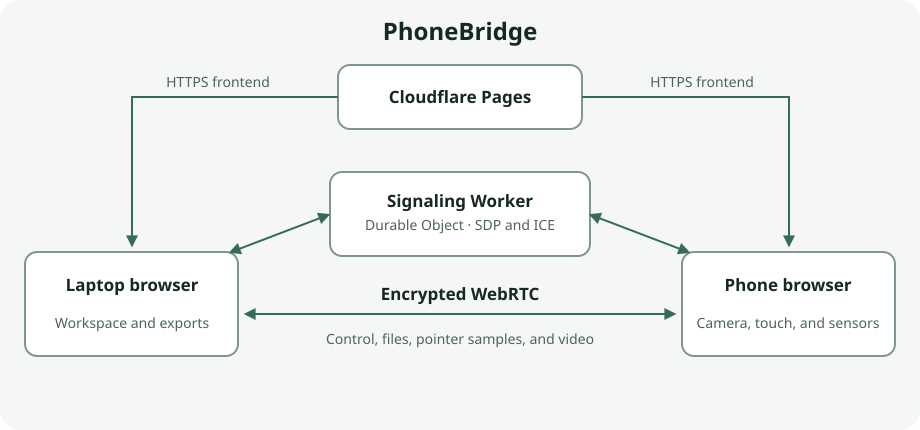

# PhoneBridge architecture

| Component                                | Responsibility                                                                                                                                                                               |
| ---------------------------------------- | -------------------------------------------------------------------------------------------------------------------------------------------------------------------------------------------- |
| Web frontend                             | Cloudflare Pages serves the TypeScript, React, and Tailwind browser application. The laptop route is `/`, the phone opens `/p/:token`, and `/diagnostics` reports browser capabilities.      |
| Signaling Worker and room Durable Object | A short-lived room coordinates one laptop and one phone. WebSockets relay SDP and ICE. Close or expire the room according to the [roadmap](../ROADMAP.md#t05--signaling-worker).             |
| Direct WebRTC connection                 | Native RTCPeerConnection carries an ordered reliable control channel, an ordered reliable binary bulk channel, an unordered unreliable pointer channel, and the document-camera video track. |
| Browser workers                          | Vision uses OpenCV.js. PDF assembly and file hashing run off the main thread when their features are implemented.                                                                            |
| Package boundaries                       | `protocol` defines and validates data channel messages, binary framing, and SAS. `rtc` will coordinate peers and transfers. `vision`, `pdf`, and `sensors` hold feature logic outside React. |

## Pairing sequence

1. The laptop gathers its local DTLS fingerprint and acquires a room token. It puts the token in the QR URL path and the SHA-256 fingerprint in the fragment.
2. The phone joins the room. It checks the fingerprint from the QR against the laptop SDP before accepting the remote description.
3. The peers finish negotiating directly and show a verification code derived from the two negotiated fingerprints. WebRTC carries user content after pairing.
4. Either peer can end the connection and room. Later tasks add ICE restart and a fresh-QR recovery path.

STUN supports candidate discovery. TURN, when added, forwards encrypted WebRTC packets for networks that block a direct connection. The data channel and pairing contracts are in the [protocol](protocol.md) and [threat model](threat-model.md). [WebRTC security architecture](https://www.rfc-editor.org/rfc/rfc8827.html)
